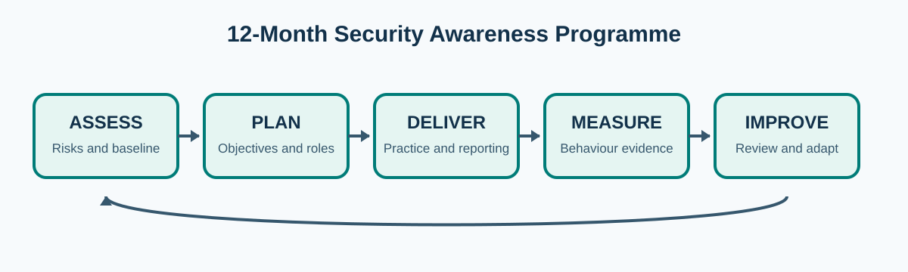
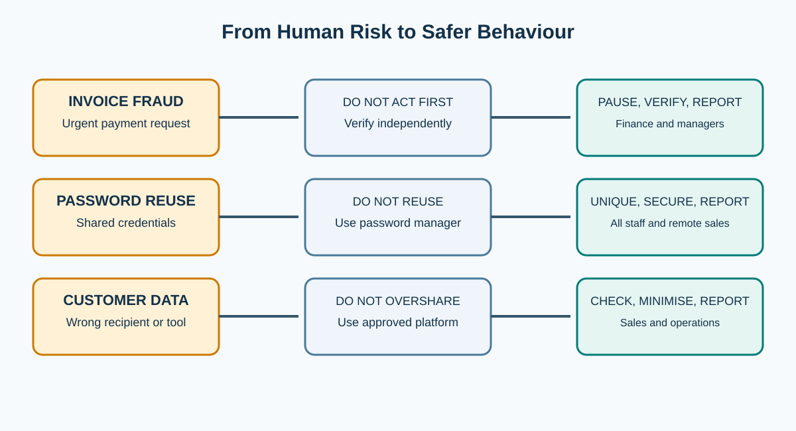
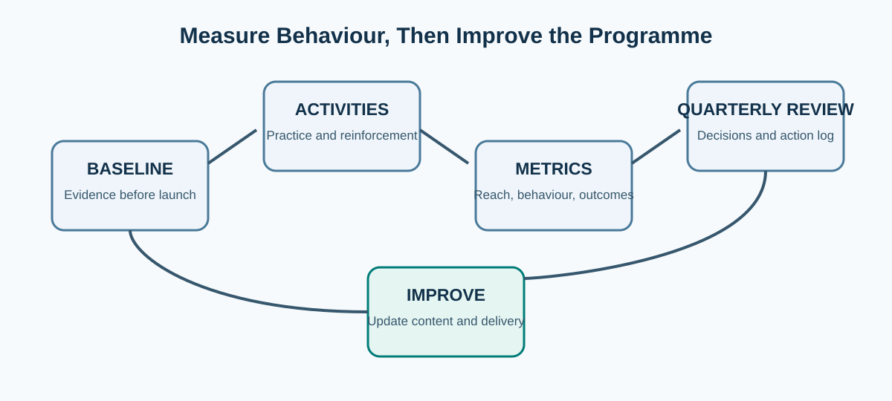

# Northbridge Logistics Security Awareness Program

**Module:** GRC206  
**Assignment:** Design a Security Awareness Program  
**Student:** Ayuba Amadi  
**Programme:** [Insert programme]  
**Student ID:** [Insert student ID]  
**Submission format:** GitHub repository  

> **Purpose.** This repository presents a practical 12-month cybersecurity awareness programme for Northbridge Logistics. It follows the lifecycle required by the assignment: **Assess, Plan, Deliver, Measure and Improve**.

## Repository guide

| File | Purpose |
|---|---|
| [This report](README.md) | The structured programme addressing Tasks 1 to 5. |
| [12-month calendar](docs/12-month-calendar.md) | The annual delivery roadmap, audience, owner and measurement points. |
| [Reflection](docs/reflection.md) | The required approximately 150-word design reflection. |
| [Sources](docs/sources.md) | Clickable evidence sources and framework references. |

## Scenario facts, assumptions and proposals

### Scenario facts

Northbridge Logistics is a fictional organisation with **800 employees** across head office, warehouses and remote sales. Recent invoice-fraud attempts have raised concern. Two staff reused passwords after a breach. The organisation handles regulated customer data and has a small security team with a modest training budget.

### Working assumptions

The programme assumes Northbridge has an approved learning platform or a basic HR completion record, an email-reporting route, and manager access to shift briefings. It also assumes that the security team can export phishing-simulation results and help-desk or incident-reporting data. These assumptions must be validated before launch.

### Proposed figures

All targets, baseline methods and improvement thresholds in this repository are **programme proposals**, not existing Northbridge results. The first baseline will determine whether targets need adjustment.

---

## Programme overview

The programme uses short, role-based activities rather than a single annual course. This is intended to fit warehouse shifts, remote work and the limited capacity of the security team. It combines awareness, practice, reporting and review. NIST SP 800-50 Rev. 1 supports a lifecycle approach that connects learning activity, behavioural change and ongoing evaluation [1].

## Task 1 — Assess

### Priority human risks

| Priority risk | Scenario basis | Unsafe action to reduce | Desired safer behaviour |
|---|---|---|---|
| **Invoice fraud and phishing** | Recent invoice-fraud attempts | Acting on an urgent payment or account-change request without independent verification | Pause, verify through an existing trusted contact route, then report the message. |
| **Password reuse and credential exposure** | Two staff reused passwords after a breach | Reusing passwords or delaying a report after suspected credential exposure | Use unique passphrases and the approved password manager; report exposure immediately. |
| **Mishandling customer data** | The company holds regulated customer data across several work settings | Sending data to the wrong recipient or using unapproved tools and devices | Use approved platforms, check recipients, minimise data and report mistakes quickly. |

### Audience segmentation and needs

| Audience | Why it needs a distinct approach | Priority topics | Suitable format |
|---|---|---|---|
| Finance, procurement and payment approvers | They may receive payment-change and invoice-fraud requests. | Invoice verification, supplier-account changes, escalation and fraud reporting. | Facilitated case exercise and quarterly fraud scenario. |
| Warehouse and shift-based staff | They have limited desk time and may use shared devices or handheld equipment. | Phishing, QR-code scams, secure use of shared devices and reporting. | Five-minute shift briefing, poster and supervisor-led practical example. |
| Remote sales and customer-facing staff | They work through email, mobile and customer data systems outside head office. | Credential protection, customer-data handling, social engineering and secure remote work. | Mobile-friendly microlearning and simulated message exercises. |
| Managers, executives and privileged IT users | They approve exceptions, receive targeted fraud attempts or hold higher-risk access. | Business email compromise, incident escalation, approval controls and leadership response. | Role-based briefing and short tabletop exercise. |

### Pre-launch baseline

Before Month 1, the security lead will create a baseline record. It will include completion data from any existing learning, suspicious-message reports per 100 staff, phishing-simulation reporting and interaction rates, known credential-reuse findings, and finance evidence of payment-change verification. Data owners will remove or minimise personal identifiers before leadership reporting.

The baseline must state its period, source, coverage and limitations. For example, low reporting may mean staff do not recognise scams, do not know the route, or fear blame. It must not be treated as proof of low attack volume.

## Task 2 — Plan

### Objectives, targets and owners

| Proposed objective | Evidence and deadline | Accountable owner |
|---|---|---|
| By the end of Month 3, deliver role-appropriate core learning to at least **90%** of active staff, with a documented catch-up plan for shifts and leave. | HR learning record and shift completion register. | HR/L&D lead, supported by department managers. |
| By the end of Month 6, achieve a **25% increase** from the pre-launch baseline in the rate of useful suspicious-message reports per 100 staff. | Security reporting mailbox or service-desk data, quality sampled monthly. | Security awareness lead. |
| By the end of Month 12, reduce the rate of unsafe interactions in comparable phishing simulations by **30%** from the pre-launch baseline, while increasing reporting. | Simulation platform results, segmented by audience and campaign type. | Security lead; managers own follow-up. |

The executive sponsor is the Operations Director, because warehouse operations, payroll-related approvals and customer service all depend on operational leadership. The Security Lead owns content, campaign design, metrics and quarterly reviews. HR/L&D maintains completion records and onboarding. Finance owns payment-verification practice. Managers protect time for briefings and use supportive follow-up.

### Risk-to-content traceability

| Risk | Audience | Topic | Activity | Metric |
|---|---|---|---|---|
| Invoice fraud | Finance, procurement, managers | Verification before payment or supplier-detail change | Realistic fraud case and callback verification exercise | Verified payment-change rate; fraud reports |
| Credential exposure | All staff; remote sales; IT | Unique passwords, password manager and prompt reporting | Microlearning plus supportive simulation follow-up | Unsafe interaction rate; credential-reuse findings |
| Customer-data handling | Sales, customer service, warehouse supervisors | Approved tools, recipient checks and rapid mistake reporting | Role-specific case study and supervisor discussion | Data-handling reports; learner feedback |

## Task 3 — Deliver

The programme begins with a visible sponsor message explaining that security reporting protects people and operations. It will state that staff will not be blamed for reporting a suspicious message or an honest mistake promptly. Deliberate misconduct remains subject to normal organisational processes, but the awareness programme is not a disciplinary channel.

### Delivery model

| Delivery element | Design choice | Reason |
|---|---|---|
| Core learning | 15-minute plain-language module with accessible transcript and mobile access. | Provides a common baseline without taking excessive operational time. |
| Warehouse reinforcement | Five-minute supervisor briefing at shift handover, supported by a single visual prompt. | Reaches staff who may not have individual desk access. |
| Finance practice | Invoice-fraud case, independent callback script and payment-change checklist. | Builds an observable control at the highest-risk decision point. |
| Remote sales reinforcement | Monthly mobile-friendly prompt and short scenario. | Fits distributed work and customer-data risk. |
| New starter onboarding | Core learning and reporting route within the first five working days; role module within 30 days. | Reduces the gap before a new employee understands expected behaviour. |

### Phishing simulation approach

The security team will run three controlled simulations during the year: a baseline in Month 2, a role-relevant follow-up in Month 6, and a comparative campaign in Month 10. Campaigns will use clear internal governance: leadership approval, legal/privacy review where needed, minimal collection of personal data, and a documented support process. The purpose is to identify learning needs, not to shame individuals.

People who interact with a simulation will receive immediate, respectful guidance explaining the cues they missed and how to report similar messages. Managers will receive aggregated team trends, unless a separate authorised process requires individual review.

### No-blame reporting route

Staff will report suspicious emails, payment requests, lost devices or potential data mistakes through the approved reporting mailbox or service desk. Communications will state: **Stop, do not forward externally, report promptly, and preserve the original message where possible.** The security team will acknowledge reports, classify them and share anonymised learning back to the workforce.

## Task 4 — Measure

| Metric | Calculation | Data source | Owner | Review | Meaning and limitation |
|---|---|---|---|---|---|
| Core learning reach | Completed core learning ÷ active in-scope staff × 100 | HR/L&D record | HR/L&D lead | Monthly | Shows reach, not safer behaviour. |
| Useful reporting rate | Reports meeting the agreed quality threshold ÷ active staff × 100 | Security mailbox/service desk | Security Lead | Monthly | A rise may show better reporting, higher attack volume, or both. |
| Simulation reporting rate | Reported simulated messages ÷ delivered simulated messages × 100 | Simulation platform | Security Lead | After each simulation | Measures recognition and use of the route; compare similar campaigns only. |
| Unsafe interaction rate | Simulation clicks or credential submissions ÷ delivered simulated messages × 100 | Simulation platform | Security Lead | After each simulation | A reduction is useful only when campaign difficulty and audience are comparable. |
| Payment-change verification rate | Documented independent verifications ÷ in-scope supplier/payment changes × 100 | Finance control record | Finance Lead | Monthly | Indicates control use; it does not prove every fraud attempt was detected. |

The Security Lead will provide a one-page monthly leadership dashboard with programme reach, behaviour indicators, trend direction, material incidents, data limitations and decisions required. It will avoid league tables that shame teams. Leadership will use it to remove obstacles such as lack of warehouse access, unavailable supervisors or insufficient finance-control capacity.

## Task 5 — Improve and sustain

### Quarterly review routine

The Operations Director chairs a quarterly review with the Security Lead, HR/L&D, Finance, a warehouse representative, a remote-sales representative and Privacy/Legal where customer-data issues require their input. The group reviews the baseline, completion gaps, reporting quality, simulation results, incident themes, learner feedback and outstanding actions.

The Security Lead maintains an action log with an owner, target date, evidence of completion and decision. Content must be reviewed earlier if there is a material fraud attempt, an emerging scam, a change to payment procedures, a relevant security incident or feedback that a delivery method is inaccessible.

### Learner feedback and recognition

Feedback will be collected through a short anonymous mobile form, warehouse shift conversations and manager feedback after exercises. The team will test whether examples make sense for each role and whether reporting routes are usable during busy shifts.

Two recognition methods are proposed:

1. A monthly anonymised "good catch" learning story explaining how a report protected the organisation.
2. A quarterly acknowledgement from managers for teams that adopt a practical safer behaviour, such as consistent independent payment verification.

Recognition will celebrate reporting and safer choices without naming people who made errors.

## Consistency check

Every activity connects to a documented risk, audience, safer behaviour, metric and review decision. The detailed sequence is available in the [12-month calendar](docs/12-month-calendar.md).

---

## References

See the complete clickable source list in [Sources](docs/sources.md).

**[1]** National Institute of Standards and Technology. (2024). *Building a Cybersecurity and Privacy Learning Program* (SP 800-50 Rev. 1).

