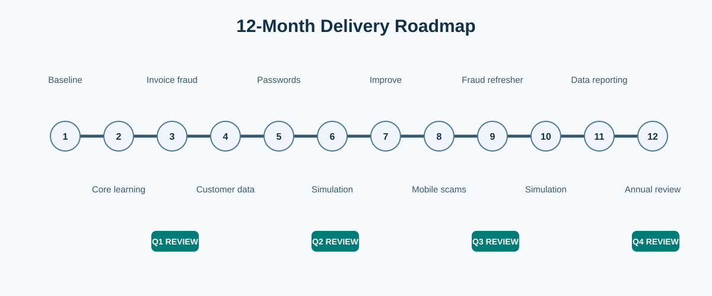

# 12-Month Security Awareness Programme Calendar

> All dates and targets are proposed planning choices. They are adjusted after the pre-launch baseline and operational review.

| Month | Activity and safer behaviour | Audience | Owner | Measurement or review point |
|---|---|---|---|---|
| 1 | Establish baseline; launch sponsor message and no-blame reporting route. | All staff | Security Lead; Operations Director | Baseline record approved; reporting route tested. |
| 2 | Core learning launch; baseline phishing simulation. | All staff | HR/L&D; Security Lead | Completion, reporting and unsafe interaction baselines. |
| 3 | Invoice-fraud verification case exercise. | Finance, procurement, managers | Finance Lead | Payment-change verification sample; **Quarterly Review 1**. |
| 4 | Customer-data handling case study and warehouse shift briefings. | Sales, customer service, warehouse supervisors | Privacy Lead; managers | Learner feedback; completion-gap review. |
| 5 | Credential protection and password-manager reinforcement. | All staff, with remote-sales emphasis | IT/Security | Credential-reuse trend and reporting rate. |
| 6 | Role-relevant phishing simulation with supportive follow-up. | All staff | Security Lead | Compare with Month 2 where campaigns are comparable; **Quarterly Review 2**. |
| 7 | Mid-year improvements and new-starter onboarding review. | Managers; HR/L&D | Security Lead; HR/L&D Lead | Action-log completion and onboarding timeliness. |
| 8 | QR-code, mobile and shared-device scam awareness. | Warehouses and remote sales | Warehouse managers; Sales Lead | Shift-briefing coverage and feedback. |
| 9 | Payment-change control refresher and fraud-reporting story. | Finance, procurement, managers | Finance Lead | Verification rate; **Quarterly Review 3**. |
| 10 | Comparative phishing simulation and targeted coaching. | All staff | Security Lead | Reporting and unsafe-interaction trends. |
| 11 | Customer-data and incident-reporting refresher. | Sales, customer service, warehouse supervisors | Privacy Lead; Security Lead | Quality of reports and feedback themes. |
| 12 | Annual review, recognition and next-year plan. | Leadership and all staff | Operations Director; Security Lead | Objective review; **Quarterly Review 4** and next-year actions. |

## Quarterly review record

Each quarterly review records participants, evidence reviewed, decisions, action owners, target dates and completion evidence. The programme is changed when evidence indicates a real operational need, not merely to add more training.

## How to use this roadmap

The calendar is a delivery guide, not a fixed sequence that overrides an operational incident. If a material invoice-fraud attempt, new scam, customer-data event or process change occurs, the Security Lead may bring forward a relevant activity after recording the reason and confirming the responsible owner. This keeps the programme responsive without allowing unplanned work to displace the core controls.

Each monthly activity should produce one or more retained outputs: an approved learning item, briefing record, anonymised feedback summary, campaign report, control sample or action-log update. These outputs give the quarterly review enough evidence to decide whether the next stage should continue, change or stop.
